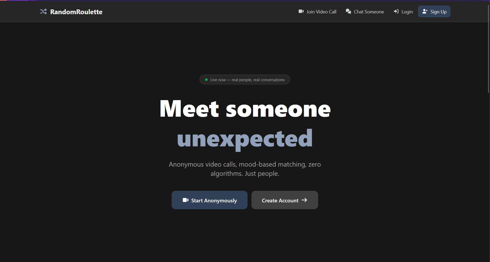
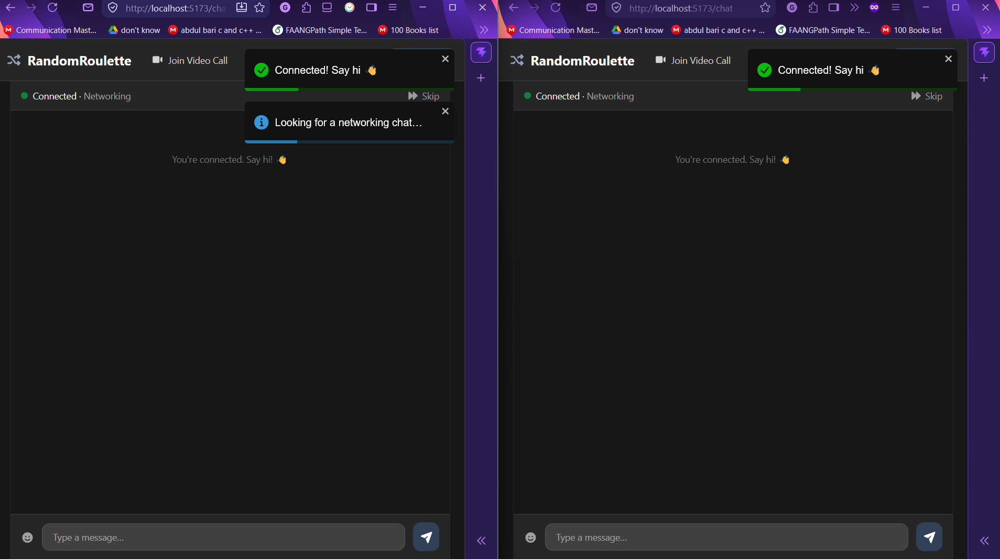
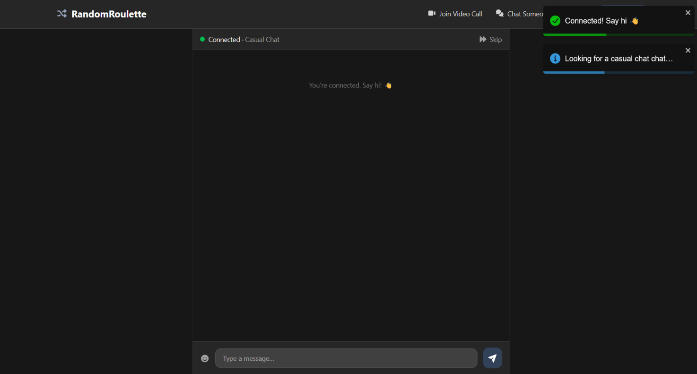

# RandomRoulette
RandomRoulette is a real-time platform for meeting strangers through video calls or text chat. Users join a shared queue, choose an optional mood, and get matched with someone waiting online. No swiping, profiles, or lengthy setup.

  
   
  <em>Choose a mood or join the general queue.</em>

## Run Locally:
### Frontend:
1. Go to a `cd client` And copy a: `cp .env.example .env`
2. Fill two env variables of ws and a server url
3. Run: `pnpm run dev` # It's running on the `localhost:5173`

### Backend:
1. Go to a `cd server` And copy a: `cp .env.example .env`
2. Fill our db env variable and also a jwt access refrsh token with also a port
3. Run: `pnpm run dev` # Which run's on the: `localhost:8000`

## How Matching Works

Users select a mood such as casual chat, study, or networking, then join the matching queue. Live queue counts show how many people are waiting.

The server matches users from the selected mood queue first, then checks the general queue. Once two users match, a room is created and WebRTC signaling begins.

## Video Calling and Chat

  
   
  <em>Video calling with picture-in-picture and live chat.</em>

Video calls use a 70/30 layout with the remote video, local preview, and chat panel. Users have controls for muting, disabling the camera, skipping, ending, saving, and reporting a session.

Skipping places the user back in the same mood queue. Ending a call opens a session summary where users can save or report the match.

## Chat-Only Mode

Users who prefer text conversations can join a separate chat-only mode. It shares the same matching queues, live counts, and skip functionality without requiring camera or microphone access.

Both video and text chat are available as independent options.

## User Reputation

  
   
  <em>User reputation based on reported behavior.</em>

Every user starts with a reputation score of 100. Reports reduce the reported user's score. Profiles display the current score without exposing who submitted a report.

## Anonymous and Account-Based Access

Users can join anonymously without creating an account. Registered users get access to conversation history, saved users, and their reputation profile.

Accounts remain optional. Users do not need email verification or a profile photo before starting a conversation.

## WebRTC and Signaling

Video and audio streams use peer-to-peer WebRTC connections. The Express server handles matchmaking and signaling by exchanging session descriptions and ICE candidates.

Media streams stay between connected peers rather than passing through the application server. Connection setup depends on NAT traversal and network conditions.

## Backend and Database

The backend uses Express and PostgreSQL. Database schemas are maintained through plain SQL migration files that run during application startup.

Persistent records include sessions, user reputation, reports, and conversation history.

## Session Records

Each completed session stores basic metadata such as duration, selected mood, and session outcome. These records support conversation history and reputation updates.

No call recordings or transcripts are stored.

## Tech Stack
- Frontend: React
- Backend: Node.js, Express
- Database: PostgreSQL
- Real-time communication: WebSockets
- Video and audio: WebRTC
- Signaling: Custom WebRTC signaling server
- Database migrations: SQL

## Contributor:
- Dipendra Sharma (Core DEv)
- Bhupendra Saud

Thanks.